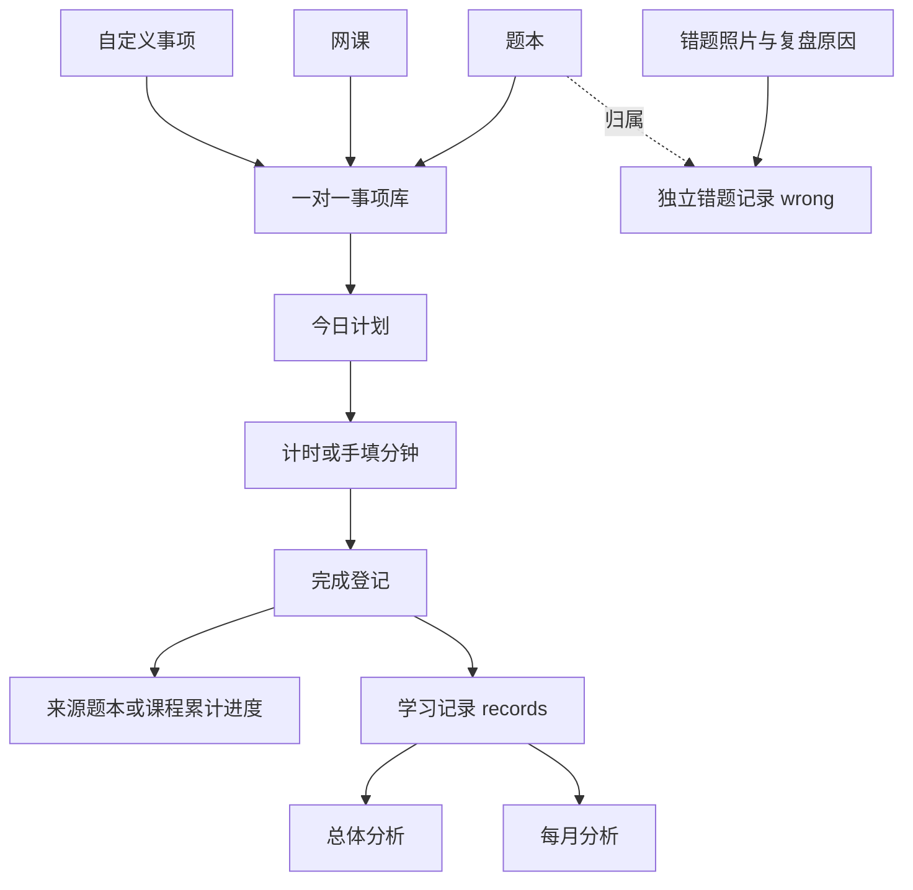

# 考公工作台：功能、实现与 Android 重设计分析

核查完成日期：2026-10-26（Asia/Tokyo）。

分析依据是当前目录的实际源码与本机浏览器显示。已查看根页面、Android 打包页面、Android Activity、Manifest、Gradle、Node 服务及部署文件，并在独立浏览器会话中查看 412×915 和 360×800 的布局。没有登录账号、连接线上 API、修改业务数据、构建 APK 或改动产品源码。现有 APK 的实际构建内容与线上部署可用性没有在本次核查中验证。

最终设计输入见同目录 `figma-android-redesign-prompt.md`。该文件是一份完整 prompt，包含确定的视觉方向、真实功能、20 个核心页面/流程、组件与状态、Android 适配规范和开发交付要求。

## 1. 产品本质与功能范围

这是一个个人备考执行与记录工具。核心价值是把纸质题本、外部网课和自定义学习事项，连接到每日计划、学习时间登记和统计复盘。

现有八科：资料分析、判断推理、言语理解、数量关系、政治理论、常识判断、申论、面试。初始数据包括 14 本题本、7 门网课，自动形成 21 个来源事项；自定义事项另行增加。前两门初始网课带有 8/12 和 2/20 的示例进度，但没有对应的学习记录，因此这些进度不会自动出现在分析中。

当前没有在线题库、题目正文/答案、自动批改、AI、OCR、课程播放、课程购买、会员支付、考试报名、学习社区和专属申论/面试评分。申论、面试可选择为题本、课程和自定义事项的科目，但没有独立训练流程。

依据：[科目与初始数据](</Users/ruyne./Library/Mobile Documents/com~apple~CloudDocs/落地项目/考公工作台/index.html:28>)；[八个导航模块](</Users/ruyne./Library/Mobile Documents/com~apple~CloudDocs/落地项目/考公工作台/index.html:283>)。

## 2. 八个模块逐项分析

| 原模块 | 已实现功能 | 设计必须保留的内容 | 当前边界 |
|---|---|---|---|
| 今日计划 | 事业编/国考/省考三个日期倒计时；从事项库添加当天计划；填写计划分钟；开始/暂停计时；完成登记；删除；今日完成数和分钟概览 | 任务类型、计划与实际分钟、运行/暂停/完成状态、三类登记入口 | 仅当天；无未来计划、历史日历、重复任务和补录；已完成不能撤销或改登记；允许多项同时计时 |
| 事项库 | 每本题本/每门课程一对一自动生成事项；默认时长；加入今天；新增/删除自定义事项 | 来源类型、科目、默认分钟、加入今天；来源资料与事项的关系 | 无搜索、筛选、排序；来源事项不能独立增删；自定义名称/科目无编辑入口 |
| 题本进度 | 新增/编辑/删除；题量进度、已做/总数、正确率、平均分钟/题 | 完整累计字段和可读数据；来源删除的影响 | 无题目内容；页数仅存储；直接修改累计值不创建学习记录 |
| 网课进度 | 新增/编辑/删除；课时进度与累计分钟；有效 http/https 链接可打开 | 课时、时间和外链；无链接态 | 没有播放器、课时目录、观看识别或自动进度 |
| 错题复盘 | 按题本分组；多图导入；复盘原因；日期；缩略图/详情大图；删除 | 照片列表、归属题本、共享原因、处理状态与详情 | 一图一条记录，同批共用原因；没有 OCR、标签、搜索、备注编辑、掌握度和复习计划 |
| 总体分析 | 最近 30/90 天或全部；八科学习分钟环图；各科每日正确率曲线 | 范围筛选、图例、分钟、日期和正确率 | 只读 records；无记录明细编辑、目标、排名、成绩预测 |
| 每月分析 | 月份选择；总分钟、题量、错题、整体正确率；八科正确率和各科分钟 | 月份、四项指标、八科数据 | 没有热力图、打卡天数、环比同比；只有时长不应表达答题能力 |
| 数据与设置 | 用户名/密码注册登录、退出；本机/云端上传读取；JSON 备份导入导出；自检；重置；APK 下载链接；头像/显示名称 | 账号状态、同步反馈、覆盖语义、文件备份和危险操作 | 无找回/修改密码、账号注销、快照恢复 UI；部分安卓文件能力仍需适配 |

主要页面渲染函数位于 [index.html:290](</Users/ruyne./Library/Mobile Documents/com~apple~CloudDocs/落地项目/考公工作台/index.html:290>) 至 314；登记与管理操作主要位于 [index.html:318](</Users/ruyne./Library/Mobile Documents/com~apple~CloudDocs/落地项目/考公工作台/index.html:318>) 至 338。

## 3. 表单字段完整清单

| 流程 | 当前字段 |
|---|---|
| 考试倒计时 | 考试日期；考试名称固定为三类，空日期显示未设置，过去日期显示 0 天 |
| 加入今天 | 事项、计划分钟；日期固定为当天 |
| 完成题本任务 | 本次做题数、本次错题数、实际分钟 |
| 完成网课任务 | 本次完成课时、实际分钟 |
| 完成自定义任务 | 事项和科目只读、实际分钟 |
| 自定义事项 | 名称、科目、默认分钟 |
| 新增/编辑题本 | 名称、科目、总题数、页数、已做题数、错题数、累计分钟 |
| 新增/编辑网课 | 名称、科目、总课时、已完成课时、累计分钟、课程链接 |
| 导入错题 | 所属题本、图片多选、复盘原因 |
| 注册/登录 | 用户名、密码；当前服务注册门槛为用户名至少 2 字符、密码至少 4 字符 |
| 个人信息 | 本机显示名称、从图片选择头像；显示名称与登录用户名分开 |
| JSON 导入 | JSON 文件，接受备份包装对象或根状态对象 |
| 分析筛选 | 总体 30 天/90 天/全部；月度年份与月份 |

题本/网课表单使用完整八科枚举。完成登记会约束本次错题数不大于本次做题数；累计数据编辑目前缺少同等完整的数值校验。重设计中的字段错误、保存禁用和覆盖确认是待补的交互要求。

## 4. 数据联动与统计口径

1. `state` 包含 profile、countdowns、books、courses、library、plans、records、wrong 等数组/对象，以一个固定 localStorage 键保存。
2. `reconcile()` 根据题本、课程生成固定来源 ID 的事项，保留自定义事项。当前会把题本/课程默认分钟重置为 30/60。
3. 加入今天会复制事项名称、类型、来源 ID、科目到计划；后续修改来源名称和科目不会同步更新已有计划的文字快照。
4. 计时记录开始时间戳；暂停或完成时累计分钟。正在计时尚未完成，不会生成 records；界面显示的本段时钟与已经累计的分钟需要区分。
5. 题本完成登记同时更新题量、错题和分钟，再写入学习记录。课程完成同时累计课时和分钟，但 records 不保存本次课时数，只保存分钟等字段。自定义登记只产生学习分钟。
6. 题本正确率 =（已做题数 − 错题数）÷ 已做题数；平均分钟/题 = 累计分钟 ÷ 已做题数。
7. 总体/月度分析只聚合 records。月度整体正确率按总题量加权，不能简单平均各科百分比。
8. 直接编辑题本/网课累计值不会回填 records。因此来源累计数据和学习记录可能不同；设计需要清楚说明，不能靠 UI 假装两者完全一致。
9. 错题照片记录与数值错题题数相互独立。上传或删除照片不会改题本错误数；登记错误数不要求照片。
10. 删除计划不撤销 records 或来源累计。删除题本/课程保留历史计划和记录，未完成的原计划可能因来源不存在而无法完成登记。

依据：[来源映射](</Users/ruyne./Library/Mobile Documents/com~apple~CloudDocs/落地项目/考公工作台/index.html:40>)、[统计聚合](</Users/ruyne./Library/Mobile Documents/com~apple~CloudDocs/落地项目/考公工作台/index.html:298>)、[三类完成登记](</Users/ruyne./Library/Mobile Documents/com~apple~CloudDocs/落地项目/考公工作台/index.html:320>)、[照片处理](</Users/ruyne./Library/Mobile Documents/com~apple~CloudDocs/落地项目/考公工作台/index.html:331>)。

## 5. 后端、同步与离线实现

### 实际账号与同步路径

后端使用 Node 核心 http/fs/path/crypto 模块。主要接口包括用户名注册、登录、读取用户信息、GET/POST 整份同步状态、备份列表和健康检查。

- 注册/登录使用用户名与密码；主同步是自建 API，与旧 Supabase 函数分开。
- 保存先写本机，600ms 防抖上传整份 state；页面启动、重新可见时尝试拉取，网络恢复时上传。
- 手动拉取和登录后拉取可用云端整份覆盖本机；静默拉取按客户端时间戳比较，没有字段级合并或版本冲突协议。
- 服务端按用户写文件，主状态使用临时文件再重命名；有每日快照和 latest 快照，但前端没有快照浏览与恢复流程。
- 照片压缩至长边最多 1100px、JPEG 质量 0.72，作为内嵌图片随 state 保存和同步。没有实际启用的独立对象存储流程。
- `cloud=null`，旧 Supabase 邮箱认证、Storage 签名 URL 与迁移函数属于遗留代码，当前页面入口未接通这些能力。

依据：[现行同步](</Users/ruyne./Library/Mobile Documents/com~apple~CloudDocs/落地项目/考公工作台/index.html:93>)、[拉取规则](</Users/ruyne./Library/Mobile Documents/com~apple~CloudDocs/落地项目/考公工作台/index.html:146>)、[服务端接口](</Users/ruyne./Library/Mobile Documents/com~apple~CloudDocs/落地项目/考公工作台/server.js:201>)。

### Android 实际形态

Android 是 AppCompatActivity + WebView。源码配置 minSdk 24、targetSdk 34、compileSdk 34。根 index.html 与 assets/index.html 已比较，字节一致。

- 启动加载部署网页，主框架网络错误后退到本地 assets 页面；HTTP 4xx/5xx 并不自动等价于该回退条件。
- HTTPS 与 file 来源没有 localStorage 迁移桥，不能假定在线来源与本地 assets 始终使用同一份数据和登录态。
- 未实现 WindowInsets/切口处理，HTML 也没有动态安全区处理。当前“全屏沉浸”文案不代表完整沉浸适配。
- 使用 adjustResize，但没有额外焦点滚动与键盘协调；系统返回也没有先关闭网页模态层的业务逻辑。
- 文件选择接入 Android 系统选择器，支持多文件结果；没有相机拍摄接口。
- 没有 DownloadListener，Blob 导出和 APK 下载在 WebView 中可靠落盘尚未验证。Dockerfile 也未复制 APK，不能仅凭下载按钮认定线上可下载。

依据：[MainActivity.java](</Users/ruyne./Library/Mobile Documents/com~apple~CloudDocs/落地项目/考公工作台/android_project/app/src/main/java/com/ruyne/kaogong/MainActivity.java:26>)、[AndroidManifest.xml](</Users/ruyne./Library/Mobile Documents/com~apple~CloudDocs/落地项目/考公工作台/android_project/app/src/main/AndroidManifest.xml:17>)、[build.gradle](</Users/ruyne./Library/Mobile Documents/com~apple~CloudDocs/落地项目/考公工作台/android_project/app/build.gradle:5>)。

## 6. 当前 UI 为什么不适合手机

### 布局结构

CSS 在 ≤620px 时仍保留 112px 固定侧栏。它占 360px 画面的约 31%，再扣主区域和卡片内边距后，任务名、按钮和图表只能挤在很窄的内容列中。

本机 412×915 浏览器样本带滚动条，实测侧栏 112px、主区 285px、扣主区左右边距后约 259px。首页任务区标题在 y≈518，今日概览在 y≈885；即使没有任何日程，概览也落到了首屏底部。360×800 的总体分析样本中，图表面板宽约 207px。数值受浏览器滚动条影响，但固定侧栏占宽的问题确定存在。

### 视觉与信息优先级

- 三个倒计时在手机上纵向堆成大卡片，挤走真正的今日执行内容。
- 页头和内容区域重复标题与说明；文字增加但信息层级没有变清楚。
- 卡片猫图固定约 70px，标题为图片预留 75px，进一步压缩题本名称。
- 渐变、玻璃、低对比浅绿、阴影和大量圆卡同时出现，视觉缺少明确主次。
- 完成、计时和删除并排，低频删除与高频学习操作同等突出。
- 正文 14px，许多说明 12px、标签 11px，在狭窄内容列中更难读。
- 桌面 SVG 曲线缩进窄列，轴文字跟着缩小；八科同时画线也缺少移动端观察手段。
- 所有流程共用桌面中心弹窗，缺少短 Sheet 与长全屏表单的区分。
- 「永不丢失」「云端不受影响」等文案超出实际同步保证。

依据：[完整 CSS](</Users/ruyne./Library/Mobile Documents/com~apple~CloudDocs/落地项目/考公工作台/index.html:12>)、[首页结构](</Users/ruyne./Library/Mobile Documents/com~apple~CloudDocs/落地项目/考公工作台/index.html:292>)、[图表结构](</Users/ruyne./Library/Mobile Documents/com~apple~CloudDocs/落地项目/考公工作台/index.html:302>)。

截图保存在 output/playwright：current-today-412x915.png、current-books-412x915.png、current-overall-360x800.png。

## 7. 确定的重设计方向

采用墨蓝 + 冷灰白的专业效率工具风格，强调稳定的信息排版、可读数字和明确状态。视觉规范完整写入最终 prompt。

五项底部导航映射：

| 新导航 | 原模块 | 呈现重点 |
|---|---|---|
| 今日 | 今日计划 | 首屏概览、紧凑三考试倒计时、可开始的任务、计时 |
| 学习 | 题本/网课/事项库 | 顶部三段切换；完整资料字段和来源关系 |
| 错题 | 错题复盘 | 按题本分组、照片导入、大图与复盘原因 |
| 分析 | 总体/每月 | 两段切换；移动图表、清楚的数据口径 |
| 我的 | 数据与设置 + 个人信息 | 登录、同步、文件备份、自检和低频操作 |

主画板采用 412×915 逻辑尺寸，另校核 360×800 和 393×873。Figma 布局标注近似 1px 对应 1dp；实际像素、文字缩放和系统区由 Android 实现处理。页面边距 20，小屏 16；触控区至少 48×48；主按钮 52；顶部应用栏 56；底部导航内容区 80，系统区另算。

底部系统手势、三键导航、挖孔区和键盘不能使用统一固定高度推断。[Android 官方安全区文档](https://developer.android.com/develop/ui/views/layout/edge-to-edge)说明了 edge-to-edge 与 insets 的处理；当前项目 targetSdk 是 34，后续升级到 35 及以上时尤其需要核对系统栏覆盖。[Android 官方无障碍指南](https://developer.android.com/guide/topics/ui/accessibility/views/apps-views)建议触控热区至少 48×48dp。

## 8. 开发时必须正视的现有问题

这些问题没有在本次修改，设计稿不能替代实现修复。

| 现象 | 原因与设计影响 |
|---|---|
| 启动后可能用旧本机状态覆盖云端 | reconcile 会改写 updated_at，随后静默拉取以新时间比较；同步成功状态必须按真实结果显示 |
| 换账号仍保留上一账号工作台 | localStorage 状态未按账号分区，退出只清凭据；新账号云端为空时可上传残留数据 |
| 同步中新增修改可能没有后续补传 | isSyncing 直接返回，没有 pending 上传保证；不能承诺实时无缝同步 |
| 恢复初始数据可能同步覆盖云端 | resetData 最终调用普通 save；需移除“云端不受影响”文案 |
| 默认事项时长改后又恢复 | reconcile 每次重建为 30/60，未保留用户改值 |
| 部分错题可从页面消失 | 删除题本后 wrong 数据仍在，但渲染仅遍历现存题本，缺少孤儿归属处理 |
| 正在计时跨天后入口丢失 | 页面只显示今天计划；多任务与跨天处理仍需定义并适配 |
| 最近 30/90 天边界少一天 | 起点保留 23:59:59，却与记录日期的 00:00:00 比较，首日记录被排除 |
| 累计值可能不合理、JSON 导入验证不完整 | 编辑可保存负值或逻辑矛盾；导入只查 books/courses 数组就替换状态 |
| 安卓离线与文件体验没有闭环 | 在线/file 两来源隔离，下载缺少原生处理，安全区与返回尚未接通 |

另外，服务端静态目录与数据文件在同一项目根，缺少明确敏感目录拒绝规则；是否已有反向代理阻拦需要部署侧核验。这个源码风险不作为 Figma 功能呈现，也未在本次尝试访问线上路径。

问题依据主要位于 [启动与保存](</Users/ruyne./Library/Mobile Documents/com~apple~CloudDocs/落地项目/考公工作台/index.html:276>)、[云拉取比较](</Users/ruyne./Library/Mobile Documents/com~apple~CloudDocs/落地项目/考公工作台/index.html:165>)、[退出](</Users/ruyne./Library/Mobile Documents/com~apple~CloudDocs/落地项目/考公工作台/index.html:256>)、[导入与重置](</Users/ruyne./Library/Mobile Documents/com~apple~CloudDocs/落地项目/考公工作台/index.html:336>)、[静态服务](</Users/ruyne./Library/Mobile Documents/com~apple~CloudDocs/落地项目/考公工作台/server.js:165>)。

## 9. 本次交付与核验

- 新增最终 Figma prompt 和本分析文档；保存三张现状截图。
- 逐项核对八个模块、主要表单、数据流与 Android 限制。
- 比较根 index 与 Android assets index，确认一致。
- 核算演示数据：倒计时 35/140/175 天；八科分钟合计 1260；题量 420、错误 84、整体正确率 80%。
- 设计 prompt 经独立复核，补全申论/面试在通用资料中的适用范围和多任务同时计时的呈现。
- 未运行产品测试或构建，因为本次没有改动产品代码；也没有验证线上服务与现有 APK。
